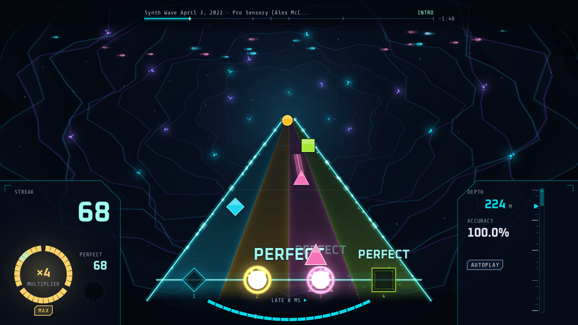
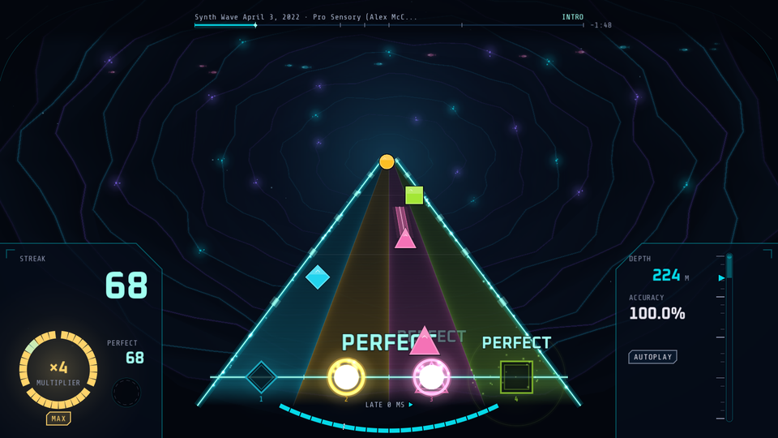

# Phase 02.2 Human UAT: does it look like a finished game?

## Current Test

**RE-TEST PENDING for v0.5.1.** The three gaps from the 2026-10-11 playtest (G1-G3, below) were fixed
in plans 02.2-26..29 and are now **fixed-pending-retest**. The v0.5.1 build and this sheet were made
in the Linux cloud container on 2026-10-11 (plan 02.2-30). The user still has to play v0.5.1 on the
Windows PC and answer the questions below. Some checks could not be done in the cloud; they are listed
in "Remaining for the Windows PC".

**Re-test steps first (about 15 minutes):**

1. **G1, hit windows:** play a song you know on **Expert** and say if the hit windows feel fair now
   (Perfect +-50 ms, Good +-100 ms, early-miss 130 ms; were 35 / 70 / 100). Notes that look like they
   sit on the hit line should score PERFECT. Also play **Sea Shanty 2 on Expert**: it has notes in the
   same lane only 92 ms apart (shorter than the new Good window). Do fast repeated notes in one lane
   still feel right, or does a press ever get counted for the wrong note?
2. **G2, background:** play one song with Settings > Display > Background = **Calm** (the default) and
   one with **Living** (the v0.5 moving trench). Say which you prefer and what to keep from the other
   (see "Background: Living vs Calm (G2)" below).
3. **G3, controller:** with **only the controller** (no keyboard, no mouse): main menu -> song select
   -> dive -> pause (Start) -> Settings -> back (B) -> quit to menu -> Calibrate Sonar -> back (B).
   Note any screen where a button did nothing. Optionally rebind a lane in Settings > Controls
   (GAMEPAD column) and then Reset Controls.

Then the original SPEC questions and flow below ("How to test").

No perf decision row: plan 24 did not record a FAILED GATE. The perf gate is **unmeasured**, not
failed. The real-GPU number is still to be measured on the PC (see "Remaining for the Windows PC").

## Gaps (user playtest on the Windows PC, 2026-10-11)

The user ran the game from source on the Windows PC (after `git reset --hard origin/main` and a
`--import` to rebuild the stale global class cache). Three gaps were found; all three are now
**fixed-pending-retest** in v0.5.1 (plans 02.2-26..29).

| # | Screen / moment | Issue (user's words) | Decision | Status | Fix (commits) |
|---|-----------------|----------------------|----------|--------|---------------|
| G1 | Gameplay, any song | "The window to hit the notes is very very small, I'm missing notes that I should be hitting, visually." | User chose **check sync + widen**: (a) verify gems are drawn exactly where the judge thinks they are (gem centre / hit line vs judged time, visual offset, scroll speeds) and fix any mismatch; (b) widen JudgeConfig to Perfect ±50 ms, Good ±100 ms, early-miss 130 ms. This deliberately changes `src/core/judge_config.gd`, so the timing gate must be re-baselined to the new commit (user-approved timing change; the other four timing-core files stay untouched). | fixed-pending-retest | 02.2-26. **Sync proven:** gem centre = receptor centre = hit line in all 60 lane x scroll x visual-offset cases; one real mismatch fixed: the triangle gem (lane 3) was drawn 2.05 px (about 2 ms at 1x) above the line (c33044a, d8b50d9). **Windows widened** to Perfect +-50 / Good +-100 / early-miss 130 ms in `judge_config.gd` only (fbcf994). **Gate re-baselined:** conductor / clock_model / input_judge / hull_score vs 72e21ce, judge_config.gd vs fbcf994 (c626ab9). Results histogram now -100..+100 ms (0402705). |
| G2 | Gameplay background (trench) | "The background pulsating is not very good, it seems to be moving which is quite distracting when playing." | User: "I like some of it, but I'd like to see another version of yours for the background." → build an alternative, calmer gameplay background variant (little or no wall motion, gentle beat response) selectable in Settings so the user can compare it in-game with the current one; provide screenshots of both. User picks one afterwards. | fixed-pending-retest | 02.2-27. New **Calm** style next to **Living**: still trench walls (frozen, smoother contour), fixed-size depth glow with a soft brightness breathe (<= 8 %) on the beat, steady colonies, less and slower snow/fish, no creature, no miss flash. **Default Calm** (also for an existing settings.cfg). Setting: **Settings > Display > Background** (CALM / LIVING), also from the pause menu's Settings. Harness scenario `background` (fcb0b74, ba17f1d, 513521a, 6e61491, 7123f51). |
| G3 | All menus (main menu, song select, results, pause, settings, calibration, dialogs) | "The game is only playable with a controller when on a song. Menus and other stuff don't work." | Bug: wire gamepad to all UI navigation (ui_up/down/left/right on D-pad + left stick, ui_accept = A/South, ui_cancel = B/East, pause = Start) and any custom menu input handling; verify every screen is navigable with a gamepad only. | fixed-pending-retest | 02.2-28: root cause was the input map: **pad A added to `ui_accept`, pad B to `ui_cancel`** (keyboard defaults kept); device-changed prompt keeps focus on its two buttons; 25 pad-only tests for menu, prompt, song select, results, fail, pause, dialogs, intro, dive (2d7771e, a6f7393, b1d7775, 9600c2f). 02.2-29: Settings rows get explicit Up/Down neighbours, a listening keyboard rebind cell cancels on pad B, sliders and the Background row move one step per stick push (was wrong direction, several steps), calibration focus per step, fail screen B = Back to Menu; 19 more pad tests; harness scenario `pad` walks the whole flow with pad events only (449fd30, c0369d8, 23bcd4a). |

SPEC answers / open questions: not answered yet (user stopped at the gaps above). Please answer them
in this re-test.

## Background: Living vs Calm (G2)

Both shots: Synth Wave April 3, 2022, Expert, autoplay, Full effects, taken by harness scenario
`background` in this run at song time **20.08 s (Living)** and **20.08 s (Calm)** (20.0849 s / 20.0767 s;
the board, HUD and song are the same, only the trench behind them differs).

| Living (v0.5 trench: walls scroll toward you and pulse on the beat) | Calm (new default: still walls, soft glow on the beat) |
|---|---|
|  |  |

Stillness (mean luma change over 0.5 s in two background rectangles left and right of the board,
clear of the board and the consoles): **Calm 0.00012 vs Living 0.02119** (Calm changes about 175x less;
the check needs Calm < 0.5 x Living). Plan 27 measured 0.00017 vs 0.02076.

| Question | Answer |
|----------|--------|
| **Which background do you prefer? Living / Calm / mix (what to keep from each)** | |
| What bothers you in the one you did not pick? | |

After you pick, a later plan removes the other style (or merges the parts you want to keep).

## How to test

**Running from source instead of the zip?** After pulling new code, run
`godot --headless --path . --import` once (or open the project in the Godot editor) **before**
launching the game. Otherwise the global class cache is stale and new screens can fail to open (this
is what happened in the 2026-10-11 playtest). The zip build does not need this.

1. Unzip `build/dist/UNDERTOW-playtest-v0.5.1.zip` into a new folder and start `undertow-debug.exe`.
   (If Windows SmartScreen appears: "More info" > "Run anyway".)
2. **Main menu:** watch the scene for a few seconds, listen for the menu music, and move through the
   items (each one shows a description and plays a soft blip).
3. **Song select:** pick a song and look at the cover, the difficulty tiles and the visualizer. Start
   one song on **Expert** and play it through.
4. **Results:** check the grade, accuracy, histogram and the three buttons. Go to Song Select and play
   one song on **Easy**.
5. **Pause / settings:** during a dive press Esc (or Start). Check the pause panel, open Settings, toggle
   **Low effects** and **Reduce motion** once each, switch **Background** (Calm / Living), then resume.
6. Answer the three SPEC questions below.
7. Look through the screenshot gallery and answer the open questions.

The zip also contains `TESTER-CHECKLIST.txt` for friends (setup, every screen, the 3 songs on
Expert / Easy, settings, a controller-only menu walk, the Calm / Living question, performance, the SPEC
questions and how to report a bug). The README has a "WHAT'S NEW IN v0.5.1" section and the gamepad
menu controls (D-pad / left stick move, A confirm, B back, Start pause; song select: LB / RB page,
Y sort, X rescan).

## SPEC questions

| # | Question | Answer (screen + song / difficulty / time if during play) |
|---|----------|-------------------------------------------------------------|
| 1 | Does it look like a finished game now? | |
| 2 | Is anything hard to read during play? | |
| 3 | Anything that feels too busy? | |

Songs played:

| Song | Difficulty | Notes |
|------|------------|-------|
| | Expert | |
| | Easy | |

Flow walked (y / n + notes):

| Step | Answer |
|------|--------|
| Menu (scene, menu music, item descriptions, blips) | |
| Song select (cover, tiles, visualizer, preview) | |
| Dive (board, explosions, HUD gauges, section names) | |
| Results (grade, accuracy, histogram, Retry / Song Select / Back to Menu) | |
| Pause > Settings > Low effects and Reduce motion > Resume | |
| Controller only: menu > song select > dive > pause > Settings > back > quit to menu > Calibrate Sonar > back (G3) | |
| Controller rebind: Settings > Controls, GAMEPAD column, rebind a lane, play, Reset Controls | |
| Sea Shanty 2 Expert: same-lane notes 92 ms apart feel right with the wider windows (G1) | |

## Open questions

| # | Question | Answer |
|---|----------|--------|
| 1 | The streak numeral is now always visible, muted below 10 (UI-SPEC default 12). Is it too busy at 0..9? (`hud_streak_0` below) | |
| 2 | The CRT sweep on the board (AV-01): noticeable enough, too much, or too little? (`gameplay_full` vs `gameplay_low`) | |
| 3 | The intro "room" was trimmed and replaced by a rig-boot stage with the same timings (D-12, UI-SPEC 9.5). Should the room come back later as drawn art? (`immersion_01_intro_rig_boot`) | |
| 4 | Accuracy now uses D-08 weighting: PERFECT 100, GOOD 50, MISS 0. Older bests were stored as hit rate, so they show grade "-" until a song is replayed (D-16). OK? | |
| 5 | Perf method (D-17): the gate is measured **uncapped** (vsync off, max_fps 0), Full-effects p95 frame time <= 4.35 ms over the 30 s densest Expert passage at 1920x1080. This replaces the SPEC's "at the 240 Hz cap" wording; the ">= 230 fps" intent is the same. OK? | |
| 6 | Perf cut steps: none applied. Plan 11 measured 2.53 ms Full p95 on the PC (gate held). The final PC measurement is still pending; no cut has been needed so far. | |
| 7 | Hit windows are now Perfect +-50 / Good +-100 / early-miss 130 ms (G1). Too easy, right, or still too strict? | |
| 8 | Which background do you prefer: Living or Calm? (see "Background: Living vs Calm (G2)") | |

## Screenshot gallery

All shots are 960x540 copies of the windowed harness screenshots (`tools/make_uat_shots.gd`), taken in
the cloud container under xvfb with software GL. Colours and layout match a real GPU; frame rate does not.

### Main menu (Full / Low effects / Reduce motion)

### Song select (album art / generated cover)

### Gameplay board

### HUD: streak

### HUD: hull and section change

### Readability: scroll 0.5x / 3x, Full / Low effects

### Pause, IMPLOSION, confirm dialog

### Settings and calibration

### Results (first record / new record / practice, not recorded)

### Intro (rig boot)

### Gameplay background: Living / Calm (G2)

Source of each shot (harness file in `build/playtest/`): menu_* = polish_02..04; songs_art_cover =
songs_10_art_cover; songs_generated_cover = songs_11_generated_cover; gameplay_* / hud_* = visual_01..29
(gameplay_trench_beat = visual_13, the last of the beat loop); pause_panel = d_01; implosion =
polish_17 (layout_04 is the same screen); confirm_dialog = d_04; settings_screen = g_01;
calibration_audio = a_07; results_* = polish_14..16; intro = immersion_01; background_living /
background_calm = background_01 / background_03. Every listed name exists in the harness output. All
32 shots were regenerated on 2026-10-11 (plan 02.2-30) from harness runs of the final v0.5.1 code.

## Automated evidence (02.2-30, v0.5.1, 2026-10-11, Linux cloud container)

Environment: Godot 4.7.2 Linux. The windowed harness ran under xvfb with Mesa llvmpipe (software GL,
about 20-24 fps) and the Dummy audio driver, one Godot instance at a time. `run_all.ps1` is
Windows-only, so each scenario was run directly (CLOUD-ENV.md). The v0.5 numbers from 02.2-25 are
replaced by this run.

| Check | Result |
|-------|--------|
| Headless gdUnit, all of res://tests | **975 test cases, 0 errors, 0 failures** (71 suites). The first full run hit the known `test_pause_overlay` flake once (song_time -0.003 s after a 2 s wait; gdUnit then skips the rest of that suite, so it reported 971); the suite alone passed 5 / 5 and the full re-run was 975 / 975 |
| Timing-core gate (`tools/check_timing_gate.ps1`) | **TIMING GATE OK**, re-baselined for G1 with the user's approval (2026-10-11): `conductor.gd`, `clock_model.gd`, `input_judge.gd`, `hull_score.gd` unchanged vs **72e21ce**; `judge_config.gd` unchanged vs **fbcf994** (the commit that widened the windows to 50 / 100 / 130 ms) |
| Autoplay, all 5 bundled songs on Expert at Full effects (autoplay5) | **26 / 26 PASS**, all-Perfect, 0 Good / 0 Miss: Synth Wave April P416, Space Synth Wave P569, Sea Shanty 2 P471, HRT P394, INVISIBLE P440 |
| `tools/dist.ps1` (pwsh, GODOT_BIN=/usr/local/bin/godot) | `build/dist/UNDERTOW-playtest-v0.5.1.zip`, **63.47 MB (66,555,875 bytes)**. 5 entries only, all under `UNDERTOW-playtest-v0.5.1/`: README.txt, TESTER-CHECKLIST.txt, undertow-debug.console.exe, undertow-debug.exe, undertow-debug.pck. SHA-256 **0997e0eaf57aed4c7a1fc13a676d2feadb396376ba374750a54fbfad5b0d3395** |
| Unzipped into a fresh `build/dist/v0.5.1_final_check`: `godot --headless --main-pack .../undertow-debug.pck -- --selftest-bundled` (Linux engine, same pck) | **BUNDLED_OK 20** (5 songs x 4 difficulties), exit 0. The pck contains no `res://.planning`, `uat-shots`, `res://tests/`, `res://tools/` or `res://build/` paths |
| `make_uat_shots.gd` | UAT_SHOTS 32 / 32 (30 earlier shots + background_living / background_calm), all from this run's harness output |
| Leftover processes | no godot / undertow process running after the checks |

Per scenario (this run, each alone):

| Scenario | PASS / FAIL | Failures (all environment) |
|----------|-------------|----------------------------|
| a | 38 / 4 | calibration measures 56.0-56.9 ms vs +40 (+-5); the 4 checks share that value. Known cloud value (deferred-items 02.2-21) |
| b | 15 / 1 (re-run alone; first pass 14 / 2) | "bot hit intended offsets < 2 ms" (max 13-25 ms bot press jitter). First pass also "late presses beyond window produce strays" 9 vs 8, from the same 25 ms late bot press; 8 / 8 on the re-run. "All judgments match JudgeConfig windows (50/100/130 ms)" PASS both times |
| d | 25 / 1 | "song_time continues from paused position (+-20 ms)" 128 ms (Dummy audio driver; fails at older commits too) |
| g | 18 / 0 | |
| layout | 43 / 0 | |
| polish | 107 / 0 | |
| immersion | 66 / 1 | "full effects hold >= 60 fps" 24.0 fps (software GL) |
| songs | 83 / 1 | "bundled gameplay frame rate >= 60 fps" 21.6 fps (software GL) |
| visual | 37 / 1 | "bio colonies brighter on the beat" (on-beat sample n 0 at ~20 fps; Living pinned) |
| **background** (G2) | **14 / 0** | Living / Calm shots at the same song time (20.085 / 20.077 s); Calm 0.00012 vs Living 0.02119 luma change over 0.5 s; style restored; real settings.cfg untouched |
| **pad** (G3) | **8 / 0** | menu, song select, pause + settings overlay (Background flips, B closes), quit confirm, menu -> settings -> B, menu -> calibration -> B; 0 keyboard events sent |
| autoplay5 | 26 / 0 | |

Not re-run in this round (unchanged since 02.2-25 / 02.2-28): c, e, f, h, i, perf. In 02.2-28 scenario
`f` (gamepad lanes) passed and `c` showed one frame-timing noise check per run (CLOUD-ENV).

### Perf (02.2-PERF.md)

Method (D-17): vsync off and `Engine.max_fps = 0` for the capture only, 1920x1080, 30 s densest Expert
window (Sea Shanty 2 from 0.07 s, 122 notes), autoplay, Full then Low effects. Gate: p95 <= 4.35 ms
uncapped (>= 230 fps).

| date | commit | plan | resolution | refresh Hz | GPU | Full p50/p95/p99 ms | Low p50/p95/p99 ms | cpu/gpu p95 ms (Full) |
|------|--------|------|------------|------------|-----|---------------------|--------------------|-----------------------|
| 2026-10-10 | 6b45995 | baseline (pre-phase) | 1920x1080 | 59.94 | AMD Radeon RX 6600 XT (opengl3) | 0.848 / 1.030 / 1.122 | 0.666 / 0.828 / 0.912 | 0.124 / 0.388 |
| 2026-10-10 | 7040289 | plan 11 (board slice) | 1920x1080 | 240.00 | AMD Radeon RX 6600 XT (opengl3) | 2.178 / 2.533 / 2.746 | 1.034 / 1.286 / 1.417 | 0.268 / 0.871 |
| PENDING | (final build) | plan 24 (final) | 1920x1080 | to log | AMD Radeon RX 6600 XT (opengl3), expected | PENDING (user's PC) | PENDING (user's PC) | PENDING |

Cloud software-GL captures (not representative, not gate results): plan 24 Full p95 57.9 / Low 42.5 ms;
this run Full p95 57.1 / Low 37.8 ms. No UI-SPEC 12 cut step has been applied.

## Remaining for the Windows PC

These could not be done or measured in the cloud container. They do not block the UAT questions above,
but they should be done before the phase is closed.

| # | Item | How | Result |
|---|------|-----|--------|
| 1 | **Perf gate (fill the PENDING row)** | `powershell -NoProfile -File tools/playtest/run_all.ps1 -Scenarios perf`. "capture window is 1920x1080" must pass. Fill the "plan 24 (final)" row in 02.2-PERF.md (date, commit, refresh Hz, Full / Low p50/p95/p99). If Full or Low p95 > 4.35 ms, apply the UI-SPEC 12 cut order one step at a time (creature, band fills, bio glow, tier rail sparks, sustain sparks, CRT sweep) and re-measure; if it still fails, write the FAILED GATE row and add a perf decision row to this sheet (W10) | |
| 2 | **Full harness re-run** | `powershell -NoProfile -File tools/playtest/run_all.ps1 -SkipDrift` (about 30 min; autoplay5 alone about 15). Expect "Scenarios failed: 0" apart from the PC-known items in deferred-items.md (scenario a 49-52 ms, scenario b single outlier, polish capture windows at 60 Hz) | |
| 3 | **Launch the exe on Windows** | Unzip the v0.5.1 zip into a fresh folder, run `undertow-debug.console.exe -- --selftest-bundled` (expect BUNDLED_OK 20), then start `undertow-debug.exe`. The zip was exported on Linux (no rcedit), so the exe's file icon / version info may differ from a Windows export; that is cosmetic. Rebuild with `tools/dist.ps1` on the PC if you want a Windows-made zip for friends | |
| 4 | **Listen** | Menu music plays and fades into Song Select; blips are soft next to the music, follow the SFX slider, and are not heard during a dive or the calibration pings | |
| 5 | **Cloud-only failures to re-check with a real GPU and WASAPI** | 60 fps checks (immersion, songs), visual "bio colonies brighter on the beat", polish capture-window checks, scenario b chord / offset checks, scenario c frame delta, scenario d / i resume checks, scenario f pad PERFECT | |
| 6 | **Scenario a calibration value** | Cloud: 56.0-60.9 ms vs +40 expected. Compare with the PC figure from 02.2-07 (49-52 ms) | |
| 7 | **Hit-window feel (G1)** | Play a song on Expert at 1x and at your usual speed with real audio (WASAPI) and the real display: notes that visually land on the receptor score PERFECT, a press while the gem still overlaps the pad is never a MISS. Sea Shanty 2 Expert / Hard: same-lane notes 92 ms apart (Medium: 150 ms) still feel right | |
| 8 | **Calm vs Living on the real GPU (G2)** | Start a dive, switch Settings > Display > Background (also from the pause menu's Settings) and compare both at full frame rate; pick one (answer in the Background section). Calm draws less than Living, so the perf gate should not change | |
| 9 | **Real controller in menus (G3)** | With a physical pad: stick sensitivity and repeat speed, no double moves on Settings rows, sliders and the Background row; A on the results screen skips the entrance without also pressing Retry. Xbox vs PlayStation: Cross = A (confirm), Circle = B (back), Options = Start via SDL; check DS4 / DualSense on Windows and that Steam Input does not remap. Prompts still say ESC / ENTER. Hot-plug a pad after launch. Rebind with a real pad: the opening A does not bind, B on a keyboard cell cancels, trigger axes bind on the GAMEPAD column | |

## Summary

total: 3 re-test steps (G1-G3) + 3 SPEC questions + 2 songs + 8 flow steps + 8 open questions + background choice + 9 PC items
passed: 0 (awaiting the user)
issues: 0 open (3 fixed-pending-retest: G1, G2, G3)
pending: all human answers (re-test steps, SPEC questions, songs, flow, open questions 1-8, Living / Calm choice); PC items 1-9

## Deferred (unchanged)

- Tune autochart density / difficulty in a later phase (Phase 2.1 UAT: "a bit harder").
- The user's full song list (Clone Hero-style songs to add later):
  https://docs.google.com/spreadsheets/d/13B823ukxdVMocowo1s5XnT3tzciOfruhUVePENKc01o/edit?gid=1870223413
